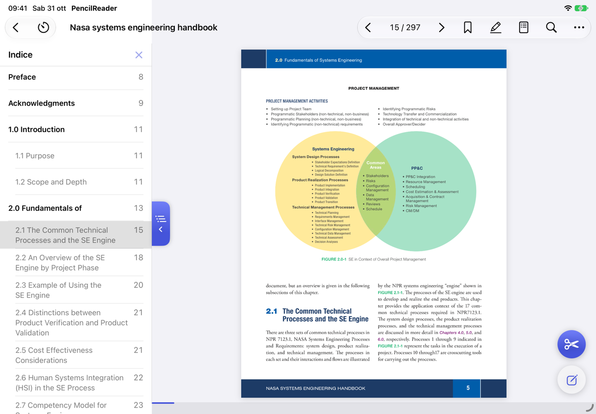
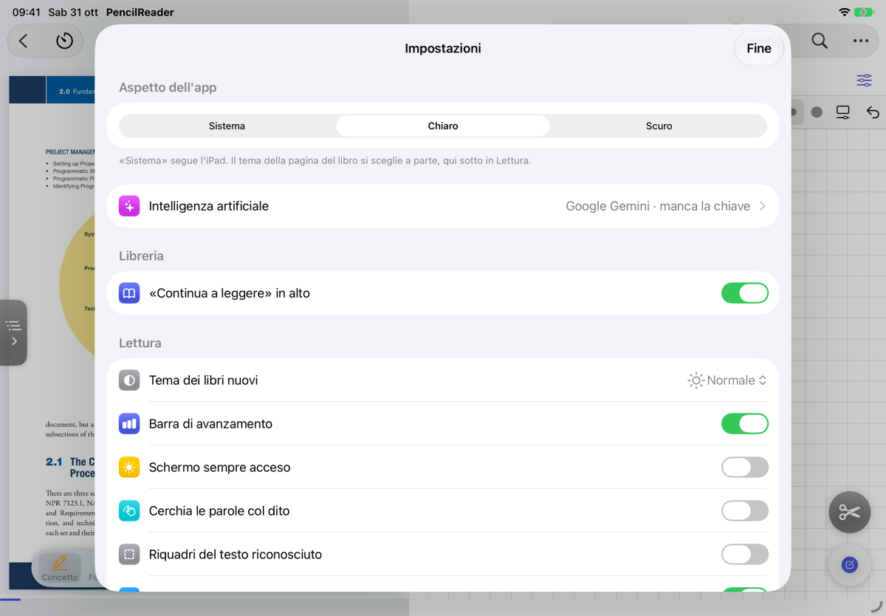
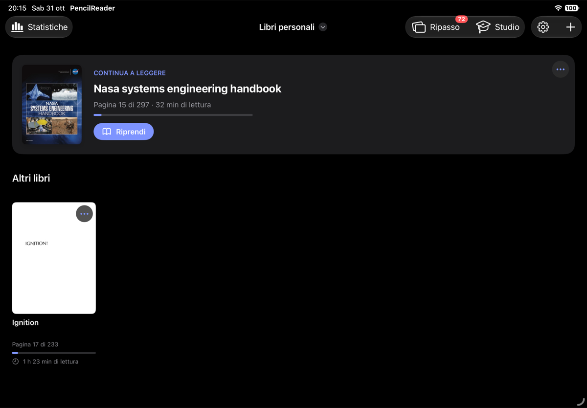

<div align="center">

# ✏️ PencilReader

**Studia sui libri tecnici in inglese con la Apple Pencil.**
Cerchia una parola e la traduci. Evidenzia, scrivi a margine, prendi appunti accanto alla pagina, ripassa.
Tutto in un'app sola per iPad, sul dispositivo, gratis e senza account.


</div>

---

## Perché PencilReader

Leggere un manuale di ingegneria in inglese vuol dire fermarsi ogni tre righe: aprire il traduttore, copiare la frase, perdere il filo. PencilReader toglie questi passaggi: **cerchi la parola con la Pencil e la traduzione compare lì, dentro la sua frase**. Intorno ci sono gli strumenti per studiare davvero: evidenziatori con un significato preciso, un quaderno accanto alla pagina, il ripasso delle parole e un timer di studio.

## ✨ In breve

| | |
|---|---|
| 🔍 **Cerchia e traduci** | Traduzione EN→IT della frase intera, con le parole cerchiate evidenziate. Pronuncia inglese con un tocco. |
| 🖍️ **Modalità studio** | Concetto, formula, da rivedere, termine, nota a margine. Il riepilogo raccoglie tutti i segni del libro. |
| 📓 **Quaderno accanto alla pagina** | Una nota per ogni pagina, forme che si raddrizzano da sole, lazo, righello. |
| 🧠 **Ripasso** | Flashcard delle parole cercate con ripetizione spaziata, rielaborazione delle pagine lette. |
| ⏱️ **Timer di studio** | Pomodoro regolabile, letture a tempo, statistiche giornaliere. |
| 📑 **Indice e salti** | Colonna dei capitoli a sinistra, ricerca nel libro, «Torna a pag. X» dopo ogni salto. |
| ☁️ **Backup** | Copia automatica di libri, note e segni in una cartella di File o di iCloud Drive. |

<p align="center">
  
  
</p>

## 📚 Libreria

- Importa **PDF**, **foto** e **scansioni** fatte con la fotocamera; organizza i libri in più librerie.
- In alto la scheda **«Continua a leggere»**: l'ultimo libro, la pagina, il tempo di lettura e un pulsante per riprendere.
- Copertine tutte della stessa forma e titoli puliti dai nomi dei file; il pulsante **«…»** su ogni libro per rinominarlo, spostarlo o eliminarlo.
- **Statistiche** sempre in alto a sinistra: tempo per libro e per giorno, pagine viste, grafico della settimana.
- **Ripasso** con il numero di parole da ripassare oggi, e il menu **Studio** con rielaborazioni e parole cercate.

## 🔍 Lettura e traduzione

- Il testo di ogni pagina viene riconosciuto sul dispositivo (Vision), anche per tutto il libro in sottofondo.
- **Cerchia una parola con la Pencil**: traduzione italiana della frase intera (framework Translation di Apple), dizionario di sistema, copia.
- **Ascolta**: la pronuncia inglese della parola cerchiata.
- **Chiedi all'IA** (facoltativo): spiegazione breve del termine e del suo senso in quella frase, con Gemini o DeepSeek e la tua chiave.
- **Indice del PDF** in una colonna a sinistra, aperta e chiusa da una linguetta sul bordo: segue il capitolo che stai leggendo.
- **«Torna a pag. X»** dopo ogni salto da indice, ricerca, miniature o segnalibri.
- Ricerca in tutto il libro, griglia delle pagine, segnalibri con nome, zoom con le dita.
- Temi della pagina **Normale, Seppia, Notte** o come il sistema, scelti libro per libro.
- **Ritaglio dello schermo** con un grande pulsante sempre a portata: disegni attorno a una zona con la Pencil e la copi.
- Barra di avanzamento sottile in fondo alla pagina; tenendo premuto un comando compare cosa fa.

## 🖍️ Modalità studio

- Evidenziatori **arancione** (concetto), **azzurro** (formula) e **rosa** (da rivedere) che seguono la riga e non si scuriscono ripassando; sottolineatura dei termini e penna per le domande a margine.
- Una **guida** spiega come studiare con i segni, secondo la ricerca sull'apprendimento.
- Il **riepilogo** ritaglia tutti i segni dalle pagine e li raggruppa per colore, con salto alla pagina.
- Con l'IA, i pezzi staccati dello stesso concetto diventano **una scheda sola** con il nome del concetto.

## 📓 Quaderno

- Un quaderno accanto a ogni pagina (sotto la pagina con l'iPad in verticale), con il divisore da trascinare.
- A quadretti, a righe o bianco; barra degli strumenti in alto o in basso, personalizzabile.
- Tenendo fermo il tratto diventa una **forma** (linee, archi, curve, figure), modificabile toccandola.
- **Lazo** con menu sotto la selezione, gomma a pixel o a tratto intero, righello, levigatura dei tratti regolabile.
- Scorri a destra per annullare, a sinistra per ripetere.

## 🧠 Ripasso e timer

- **Parole cercate** salvate per libro, filtrabili, esportabili in un file di testo; si cancellano tutte con un tocco.
- **Flashcard** con ripetizione spaziata (SM-2 semplificato).
- **Fissa la lettura**: a fine lettura rielabori a mano le pagine lette e le confronti con l'IA; le rielaborazioni restano da rileggere.
- **Timer Pomodoro** (25/5 regolabile) e lettura a tempo, con notifica a fine blocco.

## ⚙️ Impostazioni, aspetto e backup

<p align="center">
  
  
</p>

- **Una sola schermata** con tutto: IA, libreria, lettura, quaderno, timer, studio, esportazione, backup e dati, con interruttori per gli on/off.
- **Aspetto dell'app**: Sistema, Chiaro o Scuro.
- **Schermo sempre acceso** mentre leggi, suggerimenti, tema dei libri nuovi, cerchiare col dito.
- **Backup** in una cartella a scelta, anche in iCloud Drive: automatico una volta al giorno, manuale o ripristino. Copia libri, parole, statistiche, note del quaderno, segni di studio, segnalibri, concetti IA e impostazioni; restano gli ultimi 5.
- **Esporta in PDF** il libro annotato, con i segni di studio e le note del quaderno affiancate o in pagine a parte.

## 🔒 Privacy

Libri, note e parole restano sull'iPad. La traduzione e il riconoscimento del testo funzionano sul dispositivo. Solo «Chiedi all'IA» e i concetti del riepilogo, se li attivi, mandano il testo interessato al servizio scelto, con la tua chiave salvata nel Portachiavi.

## 🛠️ Struttura

- `PencilReader/`: l'app SwiftUI.
- `ReaderCore/`: la logica pura (lazo, testo della pagina, ricerca, parole e ripasso, forme e levigatura, segni di studio e riepilogo, segnalibri, ritaglio, esportazione PDF, Pomodoro, statistiche), testabile su macOS con `swift test`.
- `project.yml`: progetto Xcode generato con [XcodeGen](https://github.com/yonaskolb/XcodeGen).

## 📲 Installazione

Serve un Mac con Xcode e XcodeGen (`brew install xcodegen`).

**Con SideStore (consigliato, si rinnova da solo sull'iPad):** compila un `.ipa` non firmato e installalo da SideStore.

```bash
xcodegen generate
xcodebuild -project PencilReader.xcodeproj -target PencilReader -configuration Release \
  -sdk iphoneos -arch arm64 CODE_SIGNING_ALLOWED=NO SYMROOT=build
mkdir -p Payload && cp -R build/Release-iphoneos/PencilReader.app Payload/ && zip -qr PencilReader.ipa Payload
```

**Con il cavo e Xcode:** con l'iPad collegato e sbloccato, `./installa.sh`. Con un account Apple gratuito l'app va reinstallata ogni 7 giorni.

## 🚧 Da sviluppare

- **Riordino della scrittura nel quaderno**: raddrizza le righe scritte a mano e le mette dentro i quadretti. Tolto dall'app finché non funziona bene; il codice (HandwritingTidier, NotebookTidying) è nel ramo locale `riordino-da-sviluppare` sul Mac, non pubblicato.
