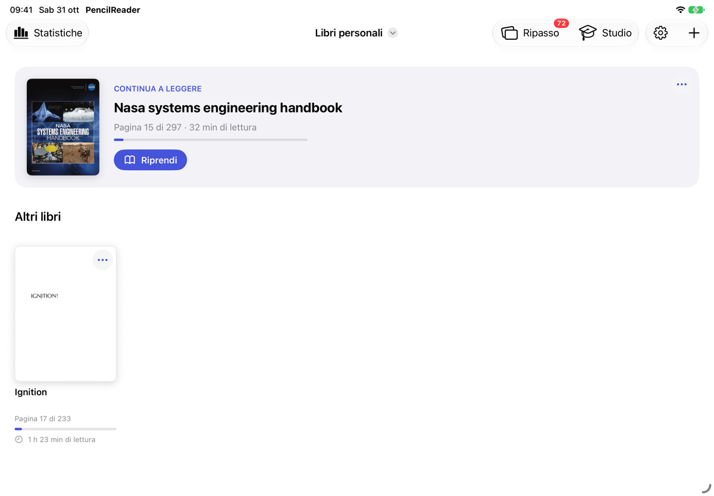
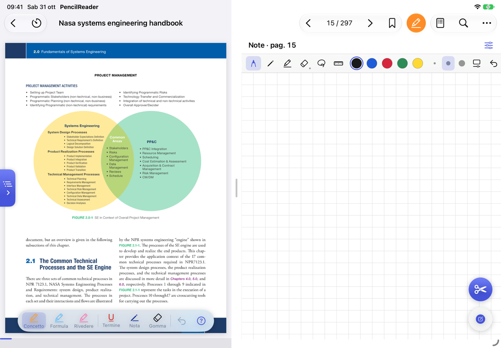

<div align="center">

# ✏️ PencilReader

**Study English technical books on iPad with the Apple Pencil.**
Circle a word to translate it. Highlight, write in the margin, take notes beside the page, review.
One iPad app that does all of it on device, for free, with no account.




</div>

---

## Why PencilReader

Reading an engineering handbook in a second language means stopping every few lines: open a translator, copy the sentence, lose the thread. PencilReader removes those steps. **Circle the word with the Pencil and the translation appears right there, inside its sentence.** Around it sit the tools for real studying: highlighters with a fixed meaning, a notebook beside the page, spaced-repetition review and a study timer.

> The interface is in Italian or English (Settings › Language, or the iPad language). Books are translated from English into Italian by default; both languages can be changed in Settings › Translation.

## ✨ At a glance

| | |
|---|---|
| 🔍 **Circle and translate** | Translation of the whole sentence (English → Italian by default), with the circled words highlighted. Pronunciation with one tap. |
| 🖍️ **Study mode** | Concept, formula, to review, term, margin note. A summary gathers every mark in the book. |
| 📓 **Notebook beside the page** | One note per page, shapes that straighten themselves, lasso, ruler. |
| 🧠 **Review** | Flashcards of the words you looked up, with spaced repetition; recaps of the pages you read. |
| ⏱️ **Study timer** | Adjustable Pomodoro, timed reading sessions, daily statistics. |
| 📑 **Outline and jumps** | Chapters column on the left, full-text search, "Back to page X" after every jump. |
| ☁️ **Backup** | Automatic copy of books, notes and marks to a folder in Files or iCloud Drive. |

<p align="center">
  
  
</p>

## 📚 Library

- Import **PDFs**, **photos** and **camera scans**; organize books in several libraries.
- A **Continue reading** card on top: the last book, its page, reading time and a button to pick up where you left off.
- Covers all share one shape and titles are cleaned from file names; the **"…"** button on each book renames, moves or deletes it.
- **Statistics** always top left: time per book and per day, pages viewed, a weekly chart.
- **Review** shows how many words are due today; the **Study** menu holds recaps and looked-up words.

## 🔍 Reading and translation

- Each page's text is recognized on device (Vision), also for the whole book in the background.
- **Circle a word with the Pencil**: translation of the whole sentence into the chosen language (Apple's Translation framework), system dictionary, copy.
- **Listen**: the English pronunciation of the circled word.
- **Ask the AI** (optional): a short explanation of the term and of its meaning in that sentence, with Gemini or DeepSeek and your own key.
- **PDF outline** in a column on the left, opened and closed by a tab on the edge; it follows the chapter you are reading.
- **"Back to page X"** after every jump from the outline, search, thumbnails or bookmarks.
- Full-text search, page grid, named bookmarks, pinch to zoom.
- Page themes **Normal, Sepia, Night** or follow the system, chosen per book.
- **Screen clipping** with a big button always at hand: draw around an area with the Pencil and it is copied.
- A thin progress bar under the page; holding a command shows what it does.

## 🖍️ Study mode

- **Orange** (concept), **blue** (formula) and **pink** (to review) highlighters that follow the line and do not darken when stroked twice; underline for terms and a pen for questions in the margin.
- A **guide** explains how to study with marks, based on research on learning from text.
- The **summary** cuts every mark out of its page and groups them by color, with a jump to the page.
- With the AI, separate pieces of the same concept become **one card** named after the concept.

## 📓 Notebook

- A notebook beside every page (below it when the iPad is upright), with a draggable divider.
- Grid, lined or blank paper; tool bar on top or at the bottom, customizable.
- Hold the stroke still and it becomes a **shape** (lines, arcs, curves, polygons), editable with a tap.
- **Lasso** with a menu under the selection, pixel or whole-stroke eraser, ruler, adjustable stroke smoothing.
- Swipe right to undo, left to redo.

## 🧠 Review and timer

- **Looked-up words** saved per book, filterable, exportable to a text file; delete them all with one tap.
- **Flashcards** with spaced repetition (simplified SM-2).
- **Fix your reading**: after reading, rewrite the pages in your own words by hand and compare with the AI; recaps stay there to reread.
- **Pomodoro timer** (25/5, adjustable) and timed reading, with a notification at the end of each block.

## ⚙️ Settings, appearance and backup

<p align="center">
  
  
</p>

- **One screen** for everything: AI, library, reading, notebook, timer, study, export, backup and data, with switches for every on/off option.
- **App appearance**: System, Light or Dark.
- **Language** of the interface: System, Italiano or English. The change applies when the app is reopened.
- **Translation**: the language of the books and the one to translate into, among those of Apple's on-device translation. Pronunciation, text recognition and the AI answers follow them too.
- **Keep the screen on** while reading, hints, theme for new books, circling with a finger.
- **Backup** to a folder of your choice, iCloud Drive included: automatic once a day, on demand, or restore. It copies books, words, statistics, notebook notes, study marks, bookmarks, AI concepts and settings; the last 5 are kept.
- **Export to PDF** the annotated book, with study marks and notebook notes side by side or on pages of their own.

## 🔒 Privacy

Books, notes and words stay on the iPad. Translation and text recognition run on device. Only "Ask the AI" and the summary's concepts, if you turn them on, send the text involved to the chosen service, with your key stored in the Keychain.

## 🛠️ Structure

- `PencilReader/`: the SwiftUI app.
- `ReaderCore/`: the pure logic (lasso selection, page text, search, words and review, shapes and smoothing, study marks and summary, bookmarks, clipping, PDF export, Pomodoro, statistics), testable on macOS with `swift test`.
- `project.yml`: Xcode project generated with [XcodeGen](https://github.com/yonaskolb/XcodeGen).

## 📲 Installation

You need a Mac with Xcode and XcodeGen (`brew install xcodegen`).

**With SideStore (recommended, it renews itself on the iPad):** build an unsigned `.ipa` and install it from SideStore.

```bash
xcodegen generate
xcodebuild -project PencilReader.xcodeproj -target PencilReader -configuration Release \
  -sdk iphoneos -arch arm64 CODE_SIGNING_ALLOWED=NO SYMROOT=build
mkdir -p Payload && cp -R build/Release-iphoneos/PencilReader.app Payload/ && zip -qr PencilReader.ipa Payload
```

**With a cable and Xcode:** with the iPad connected and unlocked, run `./install.sh`. With a free Apple account the app has to be reinstalled every 7 days.

## 🚧 Roadmap

- **Tidying handwriting in the notebook**: straightens handwritten lines and fits them into the grid. Removed from the app until it works well; the code (HandwritingTidier, NotebookTidying) lives in the local branch `riordino-da-sviluppare`, not published.
